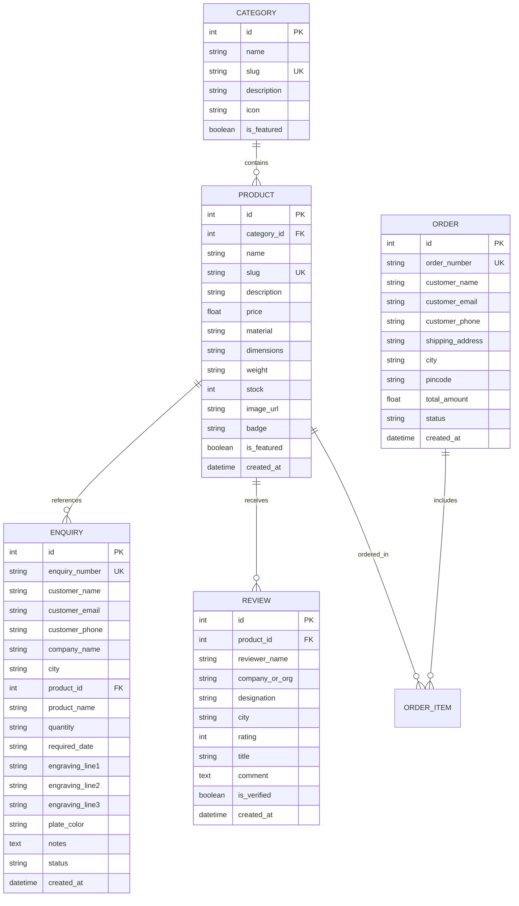

# System Architecture: Shreeji Corporates Trophy Platform

> **Document:** Architecture Blueprint  
> **Project:** Shreeji Corporates — Luxury Artisan Trophies & Awards  
> **Status:** Active / Production-Ready  
> **Last Updated:** October 2026  

---

## 1. High-Level Architecture Overview

Shreeji Corporates is engineered as a modern, decoupled **B2B Custom Manufacturing & Lead Dispatch Platform**. Unlike generic retail e-commerce stores, it is purpose-built for the institutional awards industry (similar to *Benson Trophy*, *Talisman India*, and *Trophy India*), where pricing is tiered and custom laser engraving, proof approval, and bulk fabrication workflows precede manufacturing.

```mermaid
graph TD
    Client["Client / Procurement Officer (Browser / Mobile)"] -->|HTTPS| ViteFrontend["Frontend Application (React 19 + Vite + Tailwind CSS)"]
    ViteFrontend -->|REST API (JSON / Multipart)| DjangoBackend["Backend Server (Django 6.1 + Django REST Framework)"]
    ViteFrontend -->|Direct Deep-Link| WhatsAppAPI["WhatsApp Business Direct Gateway (+91 87969 77707)"]
    
    DjangoBackend -->|ORM Queries| Database[(SQLite3 / PostgreSQL DB)]
    DjangoBackend -->|Static / Uploads| MediaStorage["Media & Image Assets (/media/trophies)"]
    DjangoBackend -->|EmailMultiAlternatives| EmailDispatcher["Notification Engine (SMTP / Console Dispatcher)"]
    
    EmailDispatcher -->|Dispatch Lead| AdminEmails["Workshop Heads & Admin Team<br>(madhu@shreejicorporates.com, rahulsingh00c@gmail.com, etc.)"]
    
    AdminUser["Admin / Ms. Madhu Sharma"] -->|Admin Console| AdminStudio["Admin Studio (/admin-panel)"]
    AdminStudio -->|REST API Updates| DjangoBackend
```

---

## 2. Technology Stack

### Frontend Architecture
- **Framework:** React 19 (Functional Components, Custom Hooks)
- **Bundler & Tooling:** Vite 8.3 + Rolldown build pipeline
- **Styling Engine:** Tailwind CSS v4 + Custom Theme Context (`ThemeContext.jsx`)
- **Animations & Interactivity:** Framer Motion (`motion`, `AnimatePresence`, layout transitions)
- **Component Primitives:**
  - `createPortal` from React DOM for viewport-isolated modals
  - 21st.dev inspired `SpotlightCard` with dynamic mouse radial gradient tracking
  - Animated `ShimmerButton` with metallic border glow
  - `CommandPalette` spotlight search (`⌘K` / `Ctrl+K`)
  - `HaikeiBackground` SVG wave & mesh generators
- **Iconography:** Lucide React (feather-style SVG icons)
- **HTTP Client:** Fetch API with centralized REST client (`src/api.js`)

### Backend Architecture
- **Framework:** Django 6.1.2 (WSGI / ASGI ready)
- **API Engine:** Django REST Framework (DRF)
- **Database:** SQLite3 (development) / PostgreSQL (production compatible)
- **CORS Management:** `django-cors-headers` (configured for local & remote origins)
- **Media Engine:** Django File Storage with relative upload resolution & symlink fallback to frontend public directory
- **Notification Engine:** Django `EmailMultiAlternatives` sending dual HTML and plain-text notifications

---

## 3. Data Models & Database Schema



---

## 4. B2B Quote Enquiry & Notification Pipeline

When a customer submits a bespoke quote request (either from the **Request Quote Modal**, the **Product Detail Page**, or the dedicated **`/request-quote` Page**), the system executes a dual-channel lead pipeline:

1. **Client Submission:**
   - Client fills out contact details, batch quantity, target event date, and custom 3-line laser plate inscription.
   - Frontend validates trust boundaries (name + phone required).
2. **Backend Processing:**
   - DRF `EnquiryListView` parses JSON payload.
   - Generates unique reference code `ENQ-XXXXXXXX` via UUID hexadecimal suffix.
   - Persists enquiry record to database.
3. **Multi-Recipient Email Dispatch:**
   - Dispatches both rich HTML and text emails via `send_enquiry_notification_email`.
   - Delivered to:
     - `madhu@shreejicorporates.com`
     - `rahulsingh00c@gmail.com`
     - `shreejicorporates@gmail.com`
     - `shreejicorporatesadmin@gmail.com`
   - Email includes full contact info, requested award, engraving lines, and a 1-click WhatsApp reply button.
4. **WhatsApp Direct Shortcut:**
   - Client can simultaneously click **"Chat on WhatsApp"**, which opens `https://wa.me/918796977707` with a pre-filled message detailing their reference number and engraving specifications.
5. **Admin Console Oversight:**
   - The enquiry appears instantly inside the **Admin Studio** (`/admin-panel` → `Client Enquiries`).
   - Admins can update workflow state (`New Enquiry` → `Under Review` → `Quote Sent` → `Order Confirmed` → `Completed`) and click one-touch WhatsApp reply.

---

## 5. Directory Structure

```text
mansi/
├── docs/                             # Project specifications & documentation
│   ├── Architecher.md               # System architecture & data flow (this file)
│   ├── design.md                    # Design system, palettes & typography
│   ├── memory.md                    # Evolution timeline & architectural decisions
│   ├── PRD.md                       # Product requirements document
│   ├── Rules.md                     # Engineering & domain rules
│   └── Task.md                      # Roadmap & task completion ledger
├── backend/                         # Django REST backend application
│   ├── config/                      # Project settings & URL routing
│   │   ├── settings.py              # Email, CORS, DB & installed apps config
│   │   ├── urls.py                  # API endpoints root
│   │   └── wsgi.py                  # WSGI entrypoint
│   ├── trophies/                    # Core awards application
│   │   ├── models.py                # Category, Product, Enquiry, Review, Order
│   │   ├── serializers.py           # DRF model serializers
│   │   ├── views.py                 # API views & email notification dispatch
│   │   ├── urls.py                  # /api/ routes
│   │   └── migrations/              # Database schema migrations
│   ├── media/trophies/              # Uploaded product and banner imagery
│   └── manage.py                    # Django management script
├── frontend/                        # React 19 + Vite frontend application
│   ├── src/
│   │   ├── components/              # Shared UI components
│   │   │   ├── Navbar.jsx           # Sticky luxury nav with category links
│   │   │   ├── Footer.jsx           # Corporate credentials & contact
│   │   │   ├── TrophyCard.jsx       # Catalog card (Bespoke Quote badge)
│   │   │   ├── RequestQuoteModal.jsx# Viewport-portal quote submission dialog
│   │   │   ├── ReviewSection.jsx    # Wall of Trust verified reviews showcase
│   │   │   └── ui/                  # 21st.dev & interactive primitives
│   │   ├── pages/                   # Application route pages
│   │   │   ├── HomePage.jsx         # Hero, 11 categories, 3D stage, reviews
│   │   │   ├── CatalogPage.jsx      # Filterable category grid & search
│   │   │   ├── ProductDetailPage.jsx# 3D stage, live engraving studio, specs
│   │   │   ├── RequestQuotePage.jsx # Full-page dedicated quote form
│   │   │   ├── AdminPanelPage.jsx   # Catalog studio & client enquiries console
│   │   │   └── OrderTrackingPage.jsx# Live stage milestone tracker
│   │   ├── context/ThemeContext.jsx # Sovereign gold palette switcher
│   │   ├── api.js                   # REST client wrappers
│   │   ├── App.jsx                  # Client routing & layout wrapper
│   │   └── main.jsx                 # React root mount
│   ├── public/                      # Static assets & public uploads
│   └── package.json                 # Node dependencies
├── .agents/                         # Autonomous agent skills & rules
│   ├── rules/ponytail.md            # Ponytail senior developer mode rules
│   └── skills/                      # Registered agent capabilities
└── AGENTS.md                        # Senior dev guidelines for paired coding
```
