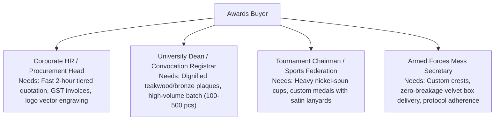

# Product Requirements Document (PRD): Shreeji Corporates

> **Product:** Shreeji Corporates Custom Trophy & Awards Digital Platform  
> **Version:** 2.0 (B2B Custom Manufacturing Model)  
> **Status:** Released & Operational  
> **Audience:** Internal Engineering, Stakeholders, Procurement Leads  

---

## 1. Executive Summary & Vision

Shreeji Corporates is a high-craftsmanship trophy and memento design house based in New Delhi with over 20 years of bespoke manufacturing legacy.

The objective of v2.0 is to deliver **India's premier digital awards ordering and quotation experience**. Rather than operating as an off-the-shelf retail webshop with fixed prices, the platform functions on an **Inquiry & Digital Layout Proof** model tailored for high-volume corporate galas, convocation ceremonies, and national sports tournaments.

---

## 2. Target Personas

---

## 3. Functional Requirements

### FR-1: Catalog & Material Hierarchy
- **FR-1.1:** The platform MUST support 11 distinct manufacturing categories:
  1. Customized & Bespoke Awards (`customized-bespoke`)
  2. Crystal & Glass Trophies (`crystal-glass`)
  3. Wooden Trophies & Plaques (`wooden-trophies`)
  4. Metal & Brass Trophies (`metal-brass`)
  5. Acrylic Awards & Plaques (`acrylic-plaques`)
  6. Sports & Championship Cups (`sports-championship`)
  7. Corporate & Leadership Awards (`corporate-leadership`)
  8. Milestone & Service Honors (`milestone-honors`)
  9. Medals, Coins & Lanyards (`medals-lanyards`)
  10. Mementos, Shields & Souvenirs (`mementos-souvenirs`)
  11. Resin & 3D Figurines (`resin-3d-sculptures`)
- **FR-1.2:** Category filtering MUST support instant reactive client-side and server-side filtering with search query integration.
- **FR-1.3:** Products MUST display materials, dimensions, weight, and stock count.

### FR-2: Pricing Policy (Zero Public Retail Rates)
- **FR-2.1:** The storefront MUST NOT display fixed individual prices (`₹`) on catalog cards, product pages, or search results.
- **FR-2.2:** Each card MUST display a `Bespoke Quote • Free Proof` indicator and direct `Enquire` button.
- **FR-2.3:** Price sorting options (`Low to High`, `High to Low`) MUST NOT exist on the public catalog.

### FR-3: Interactive 3D Motion Stage & Custom Engraving Studio
- **FR-3.1:** Products MUST offer a live 3D Motion Stage supporting mouse/touch tilt, 360° spin, and real-time crystal reflection tint switches (`Clear Crystal`, `Gold Amber`, `Sapphire`, `Emerald`).
- **FR-3.2:** The Product Detail Page MUST include a Live Custom Laser Engraving Studio.
- **FR-3.3:** The engraving studio MUST allow 3 lines of plate inscription, font selector (`Classic Serif`, `Modern Sans`, `Formal Script`), and plate color selector (`Polished Gold`, `Brushed Silver`, `Midnight Black`) with live visual preview.

### FR-4: B2B Quote Enquiry Submission System
- **FR-4.1:** Users MUST be able to request an official quote through:
  - Global `RequestQuoteModal` (Navbar, Card CTAs)
  - Dedicated `/request-quote` full-page form
  - Product-specific quote flow on `ProductDetailPage`
- **FR-4.2:** The form MUST capture:
  - Full Name (required)
  - Phone / WhatsApp (required)
  - Corporate Email Address
  - Organization / University / Club Name
  - City / Delivery Location
  - Estimated Batch Quantity (1-5 pcs, 5-20 pcs, 20-50 pcs, 50-150 pcs, 150-500 pcs, 500+ pcs)
  - Target Event Date
  - 3-Line Laser Engraving Inscription
  - Plate Color Preference
  - Custom Notes / Vector Logo details
- **FR-4.3:** Upon submission, the system MUST generate an auto-sequenced reference code `ENQ-XXXXXXXX` and present confirmation with expected response time (< 2 hours).

### FR-5: WhatsApp Direct Chat Pipeline
- **FR-5.1:** All enquiry forms and product pages MUST feature a direct **"Chat on WhatsApp"** button.
- **FR-5.2:** WhatsApp links MUST point to `+91 87969 77707` (`https://wa.me/918796977707`).
- **FR-5.3:** WhatsApp message payload MUST be pre-formatted with product name, reference ID, quantity, and engraving text.

### FR-6: Automated Multi-Recipient Email Notification Engine
- **FR-6.1:** When an enquiry is created in the backend, the system MUST automatically dispatch an email notification.
- **FR-6.2:** Emails MUST be delivered to:
  - `madhu@shreejicorporates.com`
  - `rahulsingh00c@gmail.com`
  - `shreejicorporates@gmail.com`
  - `shreejicorporatesadmin@gmail.com`
- **FR-6.3:** The email MUST contain both plain text and rich responsive HTML with complete lead specs and a 1-click WhatsApp client reply button.
- **FR-6.4:** Email delivery failures MUST fail gracefully (`fail_silently=True`) without aborting HTTP response.

### FR-7: Admin Studio & Lead Management Console
- **FR-7.1:** The `/admin-panel` Studio MUST feature:
  - Catalog Inventory Management (Add, Edit, Delete Trophies)
  - Image Upload via drag-and-drop or file picker
  - Client Enquiries Management Console
- **FR-7.2:** The Enquiries Console MUST allow status progression (`New Enquiry` → `Under Review` → `Quote Sent` → `Order Confirmed` → `Completed`).
- **FR-7.3:** The Enquiries Console MUST provide a 1-click WhatsApp reply action pre-populating client greeting and quote reference.

### FR-8: Verified Client Reviews ("Wall of Trust")
- **FR-8.1:** Homepage and Product Detail Pages MUST display verified institutional reviews.
- **FR-8.2:** Reviews MUST support category filtering (`All`, `Corporate & Banking`, `Convocations & Academia`, `Sports & Armed Forces`).
- **FR-8.3:** Users MUST be able to submit reviews via an interactive modal with star ratings and organization credentials.

---

## 4. Non-Functional Requirements (NFR)

- **NFR-1 (Performance):** Initial page bundle load under 800ms on broadband; Framer Motion transitions run at 60 FPS.
- **NFR-2 (Reliability):** React modals MUST use `createPortal` to prevent layout/z-index clipping across all screen sizes and mobile viewports.
- **NFR-3 (Accessibility):** Minimum 4.5:1 text-to-background contrast ratio (WCAG AA compliant).
- **NFR-4 (Security):** All input fields sanitized on backend; email recipients configurable through environment variables.
- **NFR-5 (Responsiveness):** 100% functional across breakpoints from 375px (iPhone SE) to 2560px (4K monitors).
