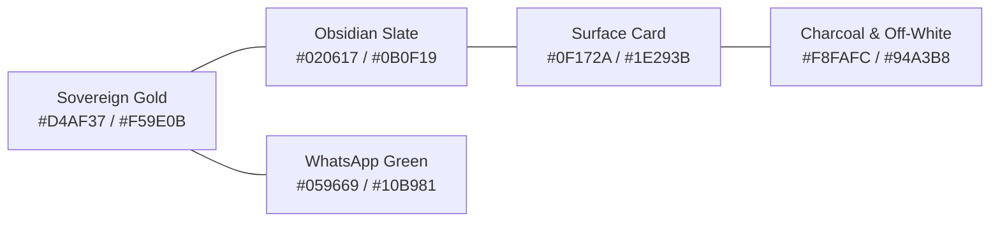

# Design System & Visual Identity: Shreeji Corporates

> **Document:** Design System & UI Specification  
> **Brand:** Shreeji Corporates (Est. 2004 — New Delhi, India)  
> **Aesthetic Theme:** Sovereign Black & 24K Gold Luxury  
> **Inspiration:** *Benson Trophy*, *Talisman India*, *21st.dev*, *RetroUI*  

---

## 1. Brand Essence & Visual Language

Shreeji Corporates manufactures heirloom-grade mementos, crystal obelisks, spun metal cups, and bespoke institutional awards for India's leading universities, armed forces messes, and Fortune 500 leadership summits.

The design language embodies **prestige, permanence, and craftsmanship**:
- **Backgrounds:** Deep Obsidian (`#020617` / `#0B0F19`) with atmospheric radial glows.
- **Accents:** Warm 24K Sovereign Gold (`#D4AF37`, `#F59E0B`, `#FDE047`) evoking electroplated gold leafing.
- **Borders & Dividers:** Subtle amber/slate borders (`border-amber-500/30`, `border-slate-800`) avoiding harsh lines.
- **Micro-Interactions:** Smooth spring physics with Framer Motion; zero jarring animations.

---

## 2. Color System & Design Tokens

| Token Name | Hex Code | Purpose / Usage |
| :--- | :--- | :--- |
| `--gold-primary` | `#F59E0B` (`amber-500`) | Primary CTA buttons, badge highlights, active tab indicators |
| `--gold-light` | `#FDE047` (`amber-300`) | Headline gradient stops, engraved plate simulated sheen |
| `--gold-dark` | `#D97706` (`amber-600`) | Hover button gradients, border accents |
| `--bg-obsidian` | `#020617` (`slate-950`) | Global page background, backdrop shadows |
| `--surface-card` | `#0F172A` (`slate-900`) | Spotlight cards, modal containers, panel containers |
| `--surface-card-border` | `rgba(245, 158, 11, 0.25)` | Subtle luxury card border with amber glow |
| `--whatsapp-emerald` | `#059669` (`emerald-600`) | Direct WhatsApp action buttons and chat links |
| `--text-primary` | `#F8FAFC` (`slate-50`) | Headlines, active values, high-contrast labels |
| `--text-secondary` | `#94A3B8` (`slate-400`) | Descriptions, metadata, secondary instructions |
| `--text-muted` | `#64748B` (`slate-500`) | Micro-copy, timestamp stamps, confidential notices |

---

## 3. Typography Hierarchy

| Style Tier | Font Family | Tailwind Class | Usage |
| :--- | :--- | :--- | :--- |
| **Hero Title** | *Cinzel / Playfair Display* | `font-serif-luxury font-extrabold` | Top hero headlines, product detail titles |
| **Section Header** | *Cinzel* | `font-heading-cinzel tracking-wider uppercase` | Section badges, category labels, modal titles |
| **Body & UI** | *Plus Jakarta Sans / Inter* | `font-sans text-sm sm:text-base` | Paragraph descriptions, button labels, inputs |
| **Technical & IDs** | *JetBrains Mono / Consolas* | `font-mono text-xs uppercase` | Reference IDs (`ENQ-30B0A794`), dimensions, dates |

---

## 4. Key Interactive Components

### 4.1 Interactive 3D Motion Stage
- **Location:** Homepage Hero & Product Detail Page
- **Mechanism:** Framer motion 3D rotation with mouse/touch parallax tilt.
- **Reflection Tint Switcher:**
  - `Clear Crystal` (Optical diamond refraction)
  - `Gold Amber` (24K warm sovereign reflections)
  - `Sapphire` (Executive blue prism glow)
  - `Emerald` (Artisan green pavilion reflection)
- **Controls:** Interactive 360° spin toggle, ambient lighting glow, and photo gallery preview.

### 4.2 Live Laser Engraving Studio
- **Location:** Product Detail Page (`ProductDetailPage.jsx`)
- **Features:**
  - Real-time engraved metal plate simulation canvas.
  - Interactive inputs for:
    - **Line 1:** Award Header / Category (e.g., *CHAMPIONSHIP WINNER*)
    - **Line 2:** Recipient / Honoree (e.g., *Presented to Col. Vikramaditya*)
    - **Line 3:** Date & Organization (e.g., *October 2026 • Tata Consultancy Services*)
  - **Typography Selector:** Classic Serif, Modern Sans, Formal Script.
  - **Plate Finish Selector:** Polished Gold, Brushed Silver, Midnight Black.
  - Live character counters with length constraints (max 35 chars per line).

### 4.3 Viewport-Isolated Request Quote Modal
- **Location:** Global modal (`RequestQuoteModal.jsx`) triggered from Navbar, Trophy Cards, and CTAs.
- **Architecture:** Rendered into `document.body` via React's `createPortal` with `z-[9999]`.
- **Layout:**
  - Pinned header with crown icon, title, and close `(X)` button.
  - Internal smooth scroll (`flex-1 min-h-0 overflow-y-auto`) ensuring no fields are ever clipped off-screen regardless of browser height.
  - Scroll lock on background page (`document.body.style.overflow = 'hidden'`).
  - Escape key dismiss handler.

### 4.4 21st.dev SpotlightCard & ShimmerButton
- **SpotlightCard:** Tracks mouse pointer coordinates using CSS variables (`--mouse-x`, `--mouse-y`) to cast a subtle warm gold radial illumination on hover.
- **ShimmerButton:** Features an animated moving metallic light band along the border for primary actions.

---

## 5. Anti-Patterns Explicitly Avoided

1. **NO Retail E-Commerce Prices:** Real custom trophy manufacturers do not sell bespoke trophies at fixed retail rates. All prices are replaced with `Bespoke Quote • Free Laser Proof`.
2. **NO Generic Shopping Carts:** Removed "Add to Cart" and "Instant Checkout". Replaced with custom quote inquiries and direct WhatsApp chats.
3. **NO Harsh Neon Colors:** Replaced saturated neon blues and purples with sovereign warm amber, deep charcoal, and brushed brass.
4. **NO Unoperable Modals:** Eliminated nested modals inside sticky backdrop-blurred headers; all dialogs now mount via React portals.
5. **NO Unchecked Accessibility:** All text achieves minimum 4.5:1 contrast against dark background; interactive elements have visible focus states and cursor pointers.

---

## 6. Responsive Breakpoint Rules

- **Mobile (375px – 640px):** Single-column stacked layouts, full-width touch targets (minimum 44px height), collapsible mobile navigation drawer.
- **Tablet (640px – 1024px):** 2-column catalog grids, side-by-side engraving inputs.
- **Desktop (1024px – 1440px):** 3-4 column catalog grids, split-screen 3D viewer on left with customization studio on right.
- **Ultra-Wide (>1440px):** Centered `max-w-7xl` container with subtle ambient mesh background.
